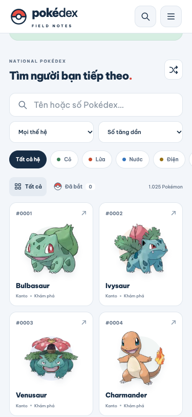
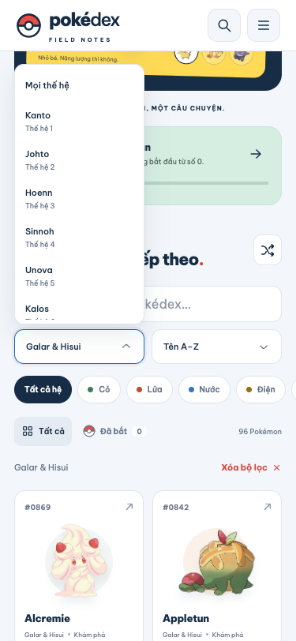

# Product Design / BA / QC — Select và tra cứu mobile

## Phạm vi

Review trực quan luồng lọc Pokédex và kiểm tra logic chọn giá trị ở375–460px. Mục tiêu: cân padding, menu do ứng dụng vẽ, thao tác bàn phím đúng và cuộn ổn định. Đây là review có ảnh và phép thử trong Chromium giả lập; không phải chứng nhận WCAG hay kiểm thử Safari trên thiết bị thật.

## Các bước và kết quả

1. **Ô chọn đóng — đã sửa.** Bản đầu dùng select hệ thống: chữ cách trái13px, phần mũi tên phụ thuộc nền tảng. Bản hiện tại dùng AppSelect, padding14px mỗi bên, inset đo thực tế15px tính cả border; chiều cao44px trên mobile.

2. **Mở và di chuyển danh sách — đã sửa.** Menu tự dựng, cùng bề ngang và cạnh trái với trigger. Item đang chọn có tick; item bàn phím đang focus có nền riêng. Arrow/Home/End/Enter/Escape và trả focus đã kiểm tra. Menu tự lật lên khi gần đáy màn hình. Ảnh02 là trạng thái trung gian trước sửa lỗi cuộn.

3. **Cuộn và chọn giá trị — đã xác minh.** Tái hiện được10px→158px do nút tự cuộn mount/unmount, đổi chiều cao và gọi scrollIntoView. Bỏ các nút đó; viewport giữ318px, qua các mốc50/100/160/80/20/0 không tự nhảy. Kiểm tra ở375,390,430,460px. Chọn Galar & Hisui cập nhật URL gen=8 và96 Pokémon; chọn A–Z cho Alcremie đứng đầu. Escape không commit mục mới.

## Bằng chứng và giới hạn

- Popup/trigger:165/165,172.5/172.5,192.5/192.5,207.5/207.5px; lệch cạnh trái0px; overflow trang0px.
- Regression thực thi trong trang: scripts/qa/select-scroll.browser.js. Không chỉ suy luận từ ảnh.
- Lỗi cùng loại được báo tại [Radix#3686](https://github.com/radix-ui/primitives/issues/3686); khả năng focus/keyboard theo [Radix Select](https://www.radix-ui.com/primitives/docs/components/select).
- Xem [QC tổng thể](pokemon-field-notes.md) và [research/BA](research-and-upgrades.md) cho chart, moveset, điều hướng và tiến hóa.
